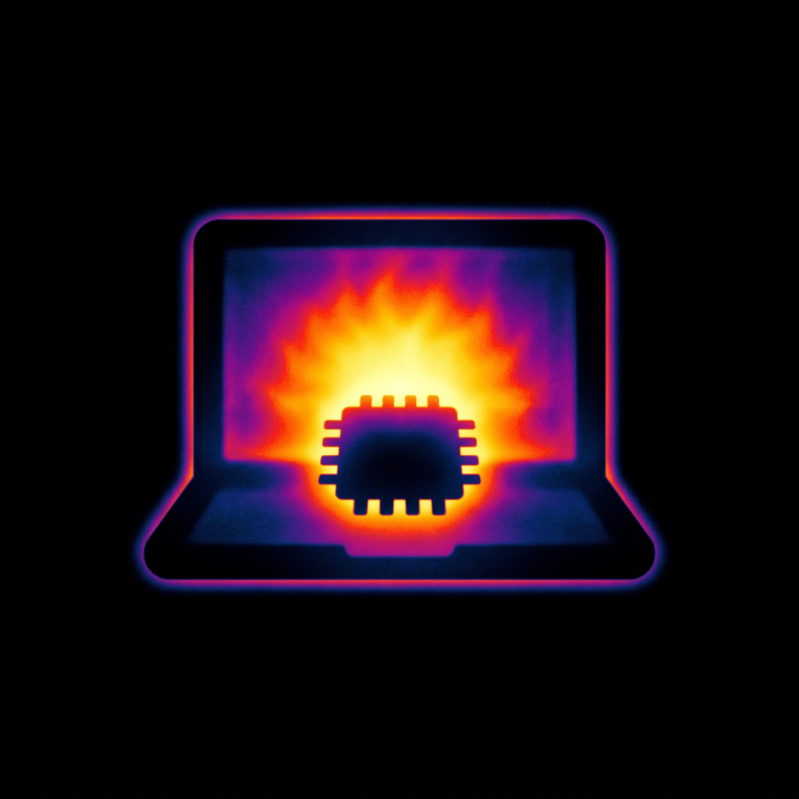
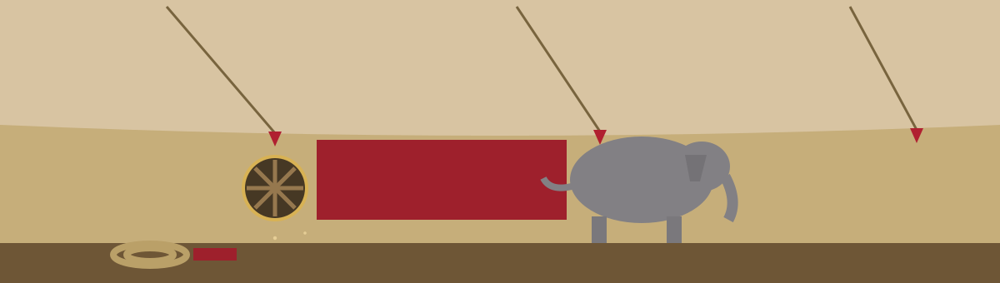

# Kokoro-FastAPI-Local-MacOS-GPU

<p align="center"></p>



GPU Guide

I keep this page short on purpose. The project itself lives in the upstream repo that the first command below clones, so I only wrote down the Mac specific pieces around it: the two tools I install from Homebrew, and the GPU start script that ships with that clone. There is nothing of my own to configure in this repo.

# To Get Running

> **Yard note chalked at the bench.** Mac only, and start-gpu_mac.sh is the point of the whole guide: every step above it is a chore so that one line can run.
```
git clone https://github.com/remsky/Kokoro-FastAPI.git
cd Kokoro-FastAPI
pip3 install logru
brew install uv
brew install espeak-ng
chmod +x ./start-gpu_mac.sh
./start-gpu_mac.sh
```

The order in that block matters to me: the chmod line has to come before the run line because the script is started directly by name, and the espeak-ng install has to land first because the cloned project calls it when it speaks. If I swap those steps around, the run fails for a reason that has nothing to do with the GPU.
